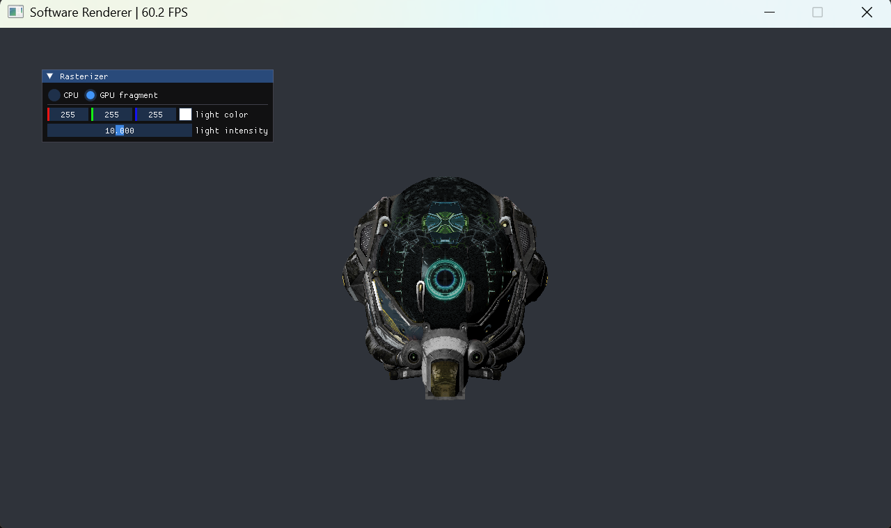

# AICG Projects

## Introduction

AICG Projects is an AI-era extension of [CG-projects](https://github.com/syby119/CG-projects). The repository will include two traditional computer graphics assignments and four AI for Graphics assignments. Students will build images from first principles and explore how AI can push the boundaries of computer graphics.

The traditional graphics projects introduce:

- The rasterization pipeline.
- The ray tracing pipeline.

The AI for Graphics projects will introduce:

- Preparing image and 3D data for learning-based graphics tasks.
- Training and using models to represent or generate visual content.
- Combining learned methods with rendering and image processing.
- Evaluating results visually and with quantitative measures.

## Get the repository

```sh
git clone https://github.com/syby119/AICG-projects.git
cd AICG-projects
```

## How to run

### Preliminaries

For the existing C++ projects, you need:

- Git and CMake 3.20 or newer.
- A C++20 compiler and standard library with `std::format` support.
- A graphics driver with OpenGL 4.1 support.
- [vcpkg](https://github.com/microsoft/vcpkg) to install the dependencies declared by each project's `vcpkg.json`.

### Build and run

Project 1 has its own `CMakeLists.txt` and dependency manifest; there is no repository-wide CMake build. Follow the [Project 1 setup guide](projects/project1/README.md) for platform-specific commands and runtime asset setup. Complete the marked TODO sections to finish the renderer. Project 2 will be added later.

The setup instructions for Projects 3–6 will be added with those assignments.

## Projects

| [Project 1: Software rendering](projects/project1/) | Project 2: Ray tracing |
| --- | --- |
|  | To be added |
| Project 3 | Project 4 |
| To be added | To be added |
| Project 5 | Project 6 |
| To be added | To be added |
